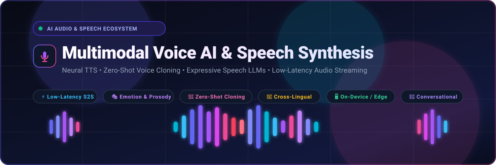

<div align="center">



# 🎙️ Awesome Multimodal Voice AI & Speech Synthesis

### 🚀 A Curated Directory of Generative Voice AI, Neural TTS, Zero-Shot Voice Cloning & Conversational Speech LLMs

[](https://awesome.re)
[](https://creativecommons.org/publicdomain/zero/1.0/)
[](https://github.com/ishandutta2007/Awesome-Multimodal-Voice-AI-Speech-Synthesis/pulls)
[](https://github.com/ishandutta2007/Awesome-Multimodal-Voice-AI-Speech-Synthesis/pulse)
[](https://github.com/ishandutta2007/Awesome-Multimodal-Voice-AI-Speech-Synthesis/stargazers)

<p align="center">
  <b>Explore state-of-the-art Neural Text-to-Speech (TTS), Instant Voice Cloning, Expressive Paralinguistic Speech Synthesis, Low-Latency Speech-to-Speech (S2S), and Edge Audio Generation Runtimes.</b>
</p>

---

[🌐 Sector Overview](#-sector-overview--market-dynamics) • [💼 SaaS & Enterprise Platforms](#-saas--hosted-platforms) • [💻 Open-Source Projects](#-open-source-github-projects) • [🛠️ Architectures & Frameworks](#-frameworks-for-custom-voice-agents) • [🤝 Contributing](#-how-to-contribute) • [⚖️ Disclaimer](#-disclaimer)

---

</div>

## 📈 Sector Overview & Market Dynamics

The global Voice AI and Speech Synthesis sector is projected to reach **$3.5B to $4.2B in 2026** and surge past **$20B to $35B+ by the early 2030s** at an accelerating **~32–38% CAGR**, driven by real-time conversational agents, zero-shot voice cloning, and sub-second speech-to-speech (S2S) multimodal foundations.

The market remains **moderately fragmented**: hyperscale cloud titans (*Microsoft, Google, AWS*) dominate general infrastructure contracts, while agile generative audio leaders (*ElevenLabs, Resemble AI, Murf.ai*) capture expressive creative and customer-experience workflows, and open-weight architectures (*Kokoro, CosyVoice, F5-TTS*) power self-hosted edge and privacy-conscious enterprise deployments.

---

## 💼 SaaS & Hosted Platforms

A ranked index of leading commercial voice synthesis platforms, enterprise speech APIs, and creative voiceover suites. Ranked in **descending order by company scale (market valuation / parent revenue)**:

| 🏢 Platform | 💰 Scale (Valuation / Revenue) | 🏷️ Starting Paid Tier | 🎁 Free Tier / Trial Limit | 🌟 Core Capabilities & Highlights |
| :--- | :--- | :--- | :--- | :--- |
| **[Microsoft Azure AI Speech](https://azure.microsoft.com/en-us/products/ai-services/ai-speech)** | **~$3.1 Trillion** *(Microsoft Cap)* | **$15.00** per 1M characters (Pay-as-you-go Neural TTS) | **Free Forever**: 500,000 neural characters/month + 20 custom voice audio endpoints | Enterprise Neural Speech with Custom Neural Voice (CNV), fine-grained SSML emotion control, and avatar lip-sync integration. |
| **[Google Cloud Text-to-Speech](https://cloud.google.com/text-to-speech)** | **~$2.1 Trillion** *(Alphabet Cap)* | **$16.00** per 1M characters (Neural2 / Chirp) | **Free Forever**: 1,000,000 characters/month for WaveNet/Neural voices + $300 new credit trial | DeepMind-powered Chirp 3 and HD Studio voices supporting 380+ voices across 50+ languages with instant voice matching. |
| **[Amazon Polly](https://aws.amazon.com/polly/)** | **~$2.1 Trillion** *(Amazon Cap)* | **$16.00** per 1M characters (Neural TTS engine) | **AWS Free Tier**: 5,000,000 characters/month for 12 months (standard & neural speech) | Managed cloud text-to-speech with Generative, Neural, and Long-Form engines featuring low-latency streaming and SSML tags. |
| **[ElevenLabs](https://elevenlabs.io)** | **~$22.0 Billion** valuation *(~$600M ARR)* | **$5.00/mo** (Starter plan, 30,000 characters/month) | **Free Forever**: 10,000 characters/month (~10 mins), 3 custom voices (non-commercial use) | Category leader in ultra-realistic multilingual TTS, conversational voice agents, sound effects synthesis, and zero-shot cloning. |
| **[Speechify](https://speechify.com)** | **~$100+ Million** valuation *(~$18M ARR)* | **$139.00/yr** (~$11.58/mo billed annually) or **$29.00/mo** | **Free Forever**: 10 standard reading voices, 1.5x playback speed limit, 5 uploaded cloud documents | Premier consumer reading and creator studio app converting PDFs, books, and articles to human-grade audio with celebrity voices. |
| **[Murf.ai](https://murf.ai)** | **~$46M – $100M** valuation *(~$8M ARR)* | **$19.00/mo** billed annually ($29.00 month-to-month) | **Free Forever**: 10 minutes total voice generation & transcription, 3 projects (no audio download) | Studio voiceover suite with granular pitch, cadence, and emphasis controls across 200+ natural voices in 20+ languages. |
| **[LOVO (Genny)](https://lovo.ai)** | **~$40 Million** valuation *(~$8M ARR)* | **$19.00/mo** billed annually ($29.00 month-to-month) | **14-Day Free Trial**: 20 minutes voice generation, full Pro features, 1GB storage, non-commercial use | Integrated AI voice generator, auto-subtitling, and video workspace with 500+ emotional voices and granular script pitch tuning. |
| **[Resemble AI](https://resemble.ai)** | **~$35M – $50M** valuation *(~$4M ARR)* | **$0.006** per second (Flex Pay-as-you-go, $0 monthly fee) | **Free Forever**: Flex model with complimentary test credits upon signup + real-time previewing | Enterprise generative voice platform pairing high-fidelity cloning with watermarking, real-time S2S, and synthetic deepfake detection. |
| **[WellSaid Labs](https://wellsaidlabs.com)** | **~$25M – $40M** valuation *(~$10M ARR)* | **$49.00/mo** (Maker plan, 250 downloads/month) | **7-Day Free Trial**: 50 audio retakes, 1 project workspace, and access to all standard voice avatars | Studio-grade synthetic voiceover engine tailored for corporate learning and development (L&D), instructional design, and broadcast media. |
| **[PlayHT](https://play.ht)** | **~$20M – $35M** valuation *(~$5M ARR)* | **$39.00/mo** (Creator plan, 250,000 words/year) | **Free Forever**: 2,500 words one-time grant, all standard voices, non-commercial attribution required | Real-time streaming conversational TTS APIs, emotional expressive voice models, and instant high-fidelity voice cloning. |

---

## 💻 Open-Source GitHub Projects

Community-driven open-weights neural TTS models, zero-shot voice cloning toolkits, and streaming voice agents. **Sorted by GitHub Stars (descending)**:

| 📦 Repository & Project | ⭐ Stars | 📜 Core Architecture & Primary Use-Case |
| :--- | :--- | :--- |
| **[GPT-SoVITS](https://github.com/bilibili/GPT-SoVITS)** | [](https://github.com/bilibili/GPT-SoVITS/stargazers) | Few-shot & zero-shot voice cloning UI capable of cross-lingual voice synthesis from just 5 seconds of clean reference audio. |
| **[Coqui TTS](https://github.com/coqui-ai/TTS)** | [](https://github.com/coqui-ai/TTS/stargazers) | Battle-tested deep learning TTS framework supporting XTTS-v2, Bark, VITS, Tortoise, and multilingual zero-shot voice cloning in 17+ languages. |
| **[ChatTTS](https://github.com/2noise/ChatTTS)** | [](https://github.com/2noise/ChatTTS/stargazers) | Generative conversational speech foundation model trained for conversational dialogue, natural pauses, laughter, and human interjections. |
| **[Bark](https://github.com/suno-ai/bark)** | [](https://github.com/suno-ai/bark/stargazers) | Transformer-based text-prompted audio model by Suno capable of generating expressive multilingual speech, background music, sighs, and crying. |
| **[Retrieval-based Voice Conversion (RVC)](https://github.com/RVC-Project/Retrieval-based-Voice-Conversion-WebUI)** | [](https://github.com/RVC-Project/Retrieval-based-Voice-Conversion-WebUI/stargazers) | Real-time speech-to-speech timbre conversion WebUI using HuBERT/ContentVec for high-accuracy vocal replacement and singing synthesis. |
| **[OpenVoice](https://github.com/myshell-ai/OpenVoice)** | [](https://github.com/myshell-ai/OpenVoice/stargazers) | Instant voice cloning framework by MIT & MyShell enabling precise independent control over speaker timbre, emotion, accent, rhythm, and language. |
| **[Fish Speech](https://github.com/fishaudio/fish-speech)** | [](https://github.com/fishaudio/fish-speech/stargazers) | SOTA Dual-AR architecture TTS framework delivering low-latency streaming audio, zero-shot cloning, and cross-lingual speech generation. |
| **[Chatterbox TTS](https://github.com/resemble-ai/chatterbox)** | [](https://github.com/resemble-ai/chatterbox/stargazers) | Resemble AI's open-source zero-shot TTS model featuring unique emotion exaggeration controls and built-in Perth perceptual neural watermarking. |
| **[CosyVoice](https://github.com/QwenAudio/CosyVoice)** | [](https://github.com/QwenAudio/CosyVoice/stargazers) | Alibaba/QwenAudio multilingual speech generation model supporting multi-speaker zero-shot voice cloning, prompt instruction, and cross-lingual transfer. |
| **[LiveKit](https://github.com/livekit/livekit)** | [](https://github.com/livekit/livekit/stargazers) | Real-time WebRTC infrastructure powering ultra-low-latency voice agents, speech-to-speech pipelines, and multimodal conversational AI. |
| **[ebook2audiobook](https://github.com/DrewThomasson/ebook2audiobook)** | [](https://github.com/DrewThomasson/ebook2audiobook/stargazers) | Automatic pipeline converting EPUB and PDF books into chapterized `.m4b` audiobooks supporting 50+ neural TTS engines and 1600+ languages. |
| **[Pipecat](https://github.com/pipecat-ai/pipecat)** | [](https://github.com/pipecat-ai/pipecat/stargazers) | Open-source Python framework for building voice agents, low-latency conversational audio bots, and multimodal pipelines with interruptibility. |
| **[F5-TTS](https://github.com/SWivid/F5-TTS)** | [](https://github.com/SWivid/F5-TTS/stargazers) | Non-autoregressive Flow Matching & Diffusion Transformer (DiT) speech synthesis providing high-fidelity zero-shot cloning without phoneme alignment. |
| **[PaddleSpeech](https://github.com/PaddlePaddle/PaddleSpeech)** | [](https://github.com/PaddlePaddle/PaddleSpeech/stargazers) | Industrial-grade all-in-one speech toolkit covering streaming ASR, neural TTS, voice translation, speaker verification, and punctuation recovery. |
| **[Piper TTS](https://github.com/rhasspy/piper)** | [](https://github.com/rhasspy/piper/stargazers) | Ultra-fast, local VITS-based neural text-to-speech optimized for Raspberry Pi, Home Assistant, and resource-constrained edge hardware. |
| **[Kokoro TTS](https://github.com/hexgrad/kokoro)** | [](https://github.com/hexgrad/kokoro/stargazers) | Featherlight 82M-parameter neural TTS model generating studio-quality natural audio faster than real-time on standard consumer CPUs and GPUs. |
| **[Amphion](https://github.com/open-mmlab/Amphion)** | [](https://github.com/open-mmlab/Amphion/stargazers) | OpenMMLab modular audio, music, and speech generation research toolkit featuring MaskGCT non-autoregressive TTS and singing voice synthesis. |
| **[ESPnet](https://github.com/espnet/espnet)** | [](https://github.com/espnet/espnet/stargazers) | End-to-end speech processing research toolkit covering ASR, TTS, speech translation, voice separation, and speech enhancement. |
| **[MeloTTS](https://github.com/myshell-ai/MeloTTS)** | [](https://github.com/myshell-ai/MeloTTS/stargazers) | High-speed multilingual TTS library by MyShell supporting English, Spanish, French, Chinese, Japanese, and Korean with CPU real-time inference. |
| **[Zonos](https://github.com/Zyphra/Zonos)** | [](https://github.com/Zyphra/Zonos/stargazers) | Open-weights 44kHz speech model trained on 200k+ hours offering granular conditioning over speaking rate, pitch, audio prefix, and emotion. |
| **[eSpeak NG](https://github.com/espeak-ng/espeak-ng)** | [](https://github.com/espeak-ng/espeak-ng/stargazers) | Compact, deterministic formant speech synthesizer supporting over 100 languages and dialects with minimal memory footprint. |
| **[StyleTTS 2](https://github.com/yl4579/StyleTTS2)** | [](https://github.com/yl4579/StyleTTS2/stargazers) | Style diffusion and adversarial training TTS model producing human-level prosodic naturalness from short reference recordings. |
| **[Parler-TTS](https://github.com/huggingface/parler-tts)** | [](https://github.com/huggingface/parler-tts/stargazers) | Controllable TTS architecture steerable via natural-language descriptions (*"A female speaker with a warm, calm tone in a quiet room"*). |
| **[MOSS-TTS](https://github.com/OpenMOSS/MOSS-TTS)** | [](https://github.com/OpenMOSS/MOSS-TTS/stargazers) | Open-source foundation model family for long-form speech, dialogue synthesis, sound effects generation, and real-time streaming TTS. |
| **[OpenedAI-Speech](https://github.com/matatonic/openedai-speech)** | [](https://github.com/matatonic/openedai-speech/stargazers) | Drop-in OpenAI `/v1/audio/speech` compatible HTTP server wrapping XTTS-v2, Piper, and MeloTTS for existing AI tool integrations. |

---

## 🛠️ Frameworks for Custom Voice Agents

Combine open-source components into production-ready multimodal voice agent pipelines:

```
[User Mic] ──> [WebRTC / LiveKit / Pipecat] ──> [Whisper / Faster-Whisper] (STT)
                                                         │
                                                         ▼
[Audio Stream] <── [Kokoro / Fish Speech / F5-TTS] <── [LLM (Claude / GPT / Llama)]
```

- **Speech-to-Text (STT)**: `openai/whisper`, `SYSTRAN/faster-whisper`, or `PaddleSpeech`.
- **Reasoning & Agent Logic**: Local models via `Ollama` / `vLLM` or hosted cloud APIs.
- **Voice Synthesis (TTS)**: `hexgrad/kokoro` (fastest CPU), `SWivid/F5-TTS` (highest zero-shot fidelity), or `fishaudio/fish-speech` (streaming).
- **Transport & Orchestration**: `livekit/livekit` or `pipecat-ai/pipecat` for sub-second bidirectional full-duplex conversations.
- **Batch Processing**: `DrewThomasson/ebook2audiobook` for long-form automated audiobook authoring.

---

## 🤝 How to Contribute

We welcome additions of promising voice AI tools and open-weights models!

1. 🍴 **Fork** the repository.
2. 📝 **Add or update** entries in `README.md` following the table schema.
3. 🔗 Include verified links, transparent pricing/free tier data, and accurate GitHub star badges.
4. 🚀 **Submit a Pull Request** with a descriptive summary of your addition.

---

## ⚖️ Disclaimer

- This repository is a **community-curated index** created solely for educational and research exploration.
- **Ethical Voice Cloning**: Synthetic speech and voice cloning technologies must strictly adhere to ethical standards and legal requirements. Always obtain verified, explicit consent before synthesizing or cloning any real individual's voice.
- **Licensing**: Review the software license (Apache 2.0, MIT, CC-BY-NC, etc.) of individual open-weights repositories before commercial deployment.

---

<div align="center">
  <b>Crafted for speech researchers, AI audio engineers, indie hackers, and open-source creators.</b><br />
  ⭐ If this directory helped your AI voice project, don't forget to star the repository!
</div>